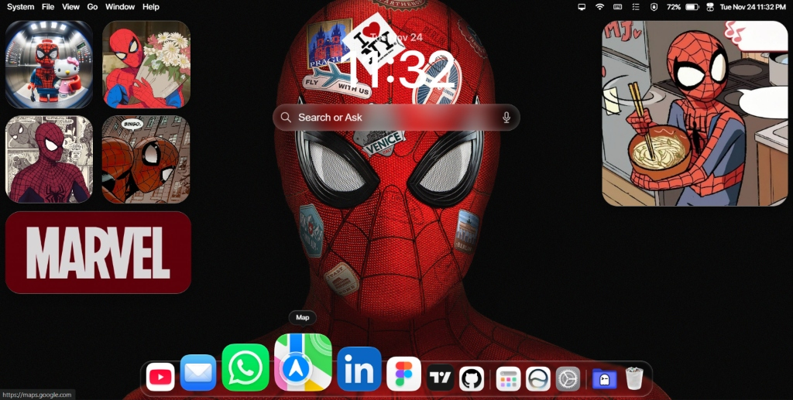

# DeskTab — Modern Desktop New Tab

[](https://macos-web-ext.vercel.app/)
[](https://microsoftedge.microsoft.com/addons/detail/desktab-modern-desktop-/chpeebogachibgcjgmfglfigmkkefcgo)


DeskTab turns your new tab into a customizable, desktop-inspired workspace. Keep your favorite shortcuts close, check the time, search the web, pin desktop widgets, and personalize your background—all from one clean start page.



## Get DeskTab

**Install from the Microsoft Edge Add-ons store:** [DeskTab — Modern Desktop New Tab](https://microsoftedge.microsoft.com/addons/detail/desktab-modern-desktop-/chpeebogachibgcjgmfglfigmkkefcgo)

**Try the live demo:** [macos-web-ext.vercel.app](https://macos-web-ext.vercel.app/)

## ✨ Key Features

- **Liquid Glass Design:** Realistic optical refraction, edge light bending, and chromatic dispersion on the dock and search bar.
- **Dynamic Desktop Dock:** Fluid macOS-style dock with smooth hover magnification, running indicators, and customizable web app shortcuts.
- **Spotlight Search:** Central search bar with live auto-complete suggestions and voice dictation support.
- **Desktop Widgets:** Pin and customize media, photo, and info widgets across your desktop in modular grid sizes (2×2, 4×4).
- **Built-in Notepad & To-Do List:** Quick access to notes and checklist tasks directly from your workspace.
- **Dedicated Launchpads:** Fast-access overlay drawers for Applications, AI tools, and Microsoft 365 services.
- **High-Definition Wallpapers:** Switch between curated aesthetic themes, custom image uploads, or live video backgrounds with IndexedDB local persistence.
- **Top Menu Bar & System Controls:** Minimalist system menu with real-time battery status, network indicator, digital clock, and dark mode toggle.
- **Workspace Customization:** Toggle individual UI components, adjust dock size and hover scaling, and configure shortcut locations.

## 🚀 Install from source

1. Clone or download this repository:
   ```bash
   git clone https://github.com/your-username/golden-etx.git
   ```
2. Open `edge://extensions` in Microsoft Edge or `chrome://extensions` in Google Chrome / Brave.
3. Turn on **Developer mode** (toggle in the top-right corner).
4. Click **Load unpacked** and select the project directory.
5. Open a new tab to start using DeskTab!

## 🔒 Privacy

DeskTab operates completely client-side. We do not run any backend servers, analytics, or user telemetry:
- Your settings, wallpapers, notes, and shortcuts are stored locally in your browser (`localStorage` and `IndexedDB`).
- To provide live search suggestions, queries typed into the search bar are queried directly against Google Suggest (with fallback to Wikipedia API). No personal data or browsing history is tracked or shared.

## 🛠️ Technology

DeskTab is engineered with clean, modern web technologies without heavy frameworks:
- **HTML5 & Vanilla JavaScript:** Fast, responsive, 0% idle CPU footprint.
- **Modern CSS3:** Custom Liquid Glass shaders, GPU-accelerated backdrop filters, and fluid spring animations.
- **SVG Displacement Filters:** Realistic optical refraction and lens distortion.
- **IndexedDB & LocalStorage:** Client-side persistence for wallpapers, notes, and preferences.

## ⚠️ Disclaimer

DeskTab is an independent browser extension and is not affiliated with, sponsored by, or endorsed by Apple Inc. or Microsoft Corporation.
