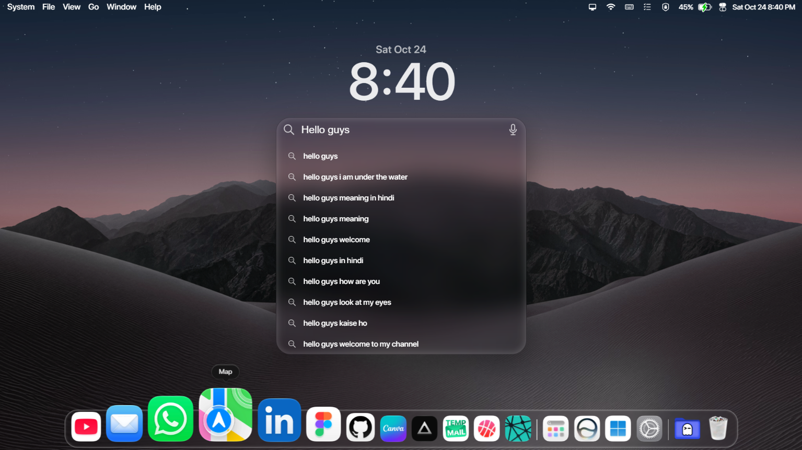

# DeskTab — Modern Desktop New Tab

[]

DeskTab turns your new tab into a customizable, desktop-inspired workspace. Keep your favorite shortcuts close, check the time, search the web, and personalize your background—all from one clean start page.

## Get DeskTab

**Install from the Microsoft Edge Add-ons store:** [DeskTab — Modern Desktop New Tab](https://microsoftedge.microsoft.com/addons/detail/desktab-modern-desktop-/chpeebogachibgcjgmfglfigmkkefcgo)

**Try the live demo:** [macos-web-ext.vercel.app](https://macos-web-ext.vercel.app/)

## Features

- **Desktop-inspired new tab:** A clean workspace with a menu bar, clock, and responsive dock.
- **Quick search:** Search from the new tab with suggestions and optional voice input.
- **Customizable shortcuts:** Add and manage links in the dock and application launchers.
- **Apps and AI launchers:** Open frequently used web apps and AI tools from dedicated panels.
- **Personalized appearance:** Choose built-in wallpapers, upload an image, or use a video background.
- **Flexible widgets and settings:** Show or hide the clock and search bar, adjust menu-bar text size, and personalize workspace details.

## Install from source

1. Clone or download this repository.
2. Open `edge://extensions` in Microsoft Edge.
3. Turn on **Developer mode**.
4. Select **Load unpacked** and choose the project folder.
5. Open a new tab to start using DeskTab.

## Privacy

DeskTab does not operate its own backend or analytics service. Your preferences and shortcuts are saved in your browser's local storage. To provide search suggestions, DeskTab sends the text entered in the search box to Google Suggest; if that service is unavailable, it tries the Wikipedia search API. These requests are handled by those third-party services.

## Technology

DeskTab is built with HTML, CSS, and JavaScript, without a front-end framework.

## Disclaimer

DeskTab is an independent browser extension and is not affiliated with, sponsored by, or endorsed by Apple Inc. or Microsoft Corporation.
